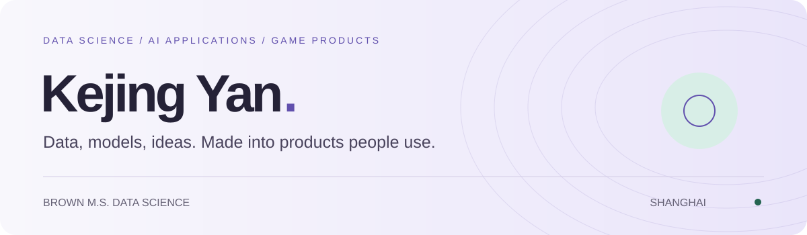
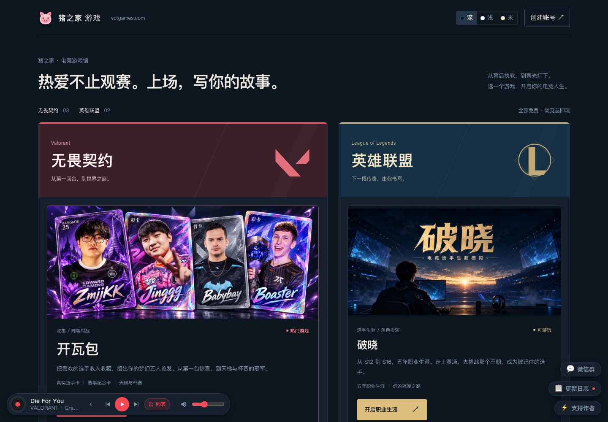
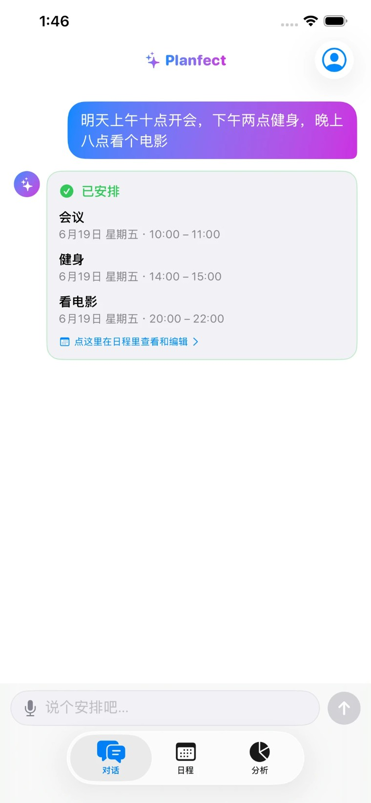
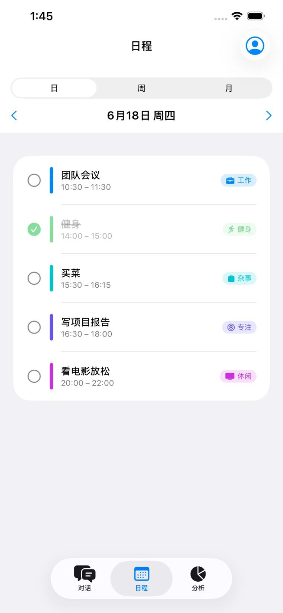
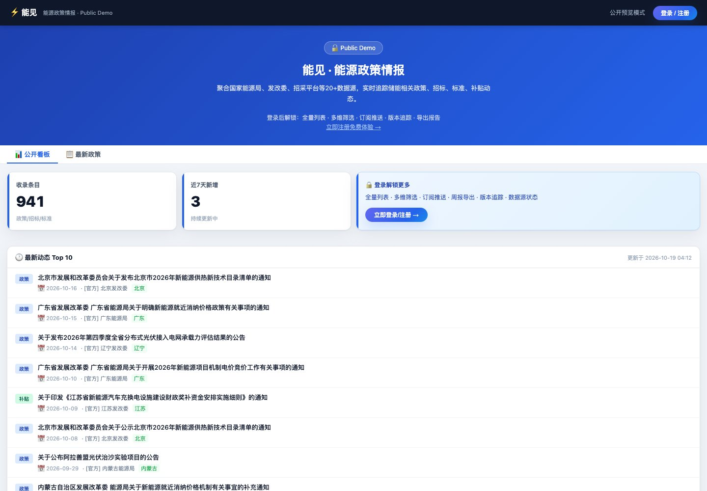

  <a href="https://kejing-yan-portfolio-production.up.railway.app/"><b>Interactive portfolio ↗</b></a> ·
  <a href="https://kejing-yan-portfolio-production.up.railway.app/resume/Kejing-Yan-Resume-EN.pdf?v=20260923">English résumé</a> ·
  <a href="https://kejing-yan-portfolio-production.up.railway.app/resume/Kejing-Yan-Resume-CN.pdf?v=20260923">中文简历</a> ·
  <a href="https://linkedin.com/in/kejing-yan">LinkedIn</a> ·
  <a href="mailto:yankejing2026@163.com">Email</a>

I'm **Kejing Yan / 闫可菁**, a Brown University M.S. in Data Science graduate based in **Shanghai**. I build AI applications, data pipelines and games — from modeling and evaluation to deployment and ongoing operation.

My background combines mathematics and statistics at Boston University with hands-on work in energy storage, healthcare and automotive consulting. Open to **AI application engineering, data science and ML engineering** opportunities.

## Selected products

### 01 / VCT Games — esports simulations & card games

I independently develop and operate **VCT 电竞经理** and **开瓦包**: player data, match simulation, game balancing, ranked play, trading and tournaments. I co-run a two-person game studio; **Lulucard and the LoL career simulator are developed by my partner**.

**74,476 cumulative browser player IDs · 4,268 daily active IDs · 156,285 market trades**

Historical admin snapshot: Oct 19, 2026. Cumulative IDs since Aug 31; daily activity is the complete Oct 18 UTC day; trades since Sep 1. Browser IDs are not unique people.

`TypeScript` `React` `Python` `PostgreSQL` `Simulation & balancing`

[Play ↗](https://vctgames.com/) · [Source](https://github.com/WeijieCao77/Val_Manager) · [My role & technical decisions](https://kejing-yan-portfolio-production.up.railway.app/#val-manager)

### 02 / Planfect — a conversational AI planner

  
  

**Solo full-stack development · Available on the App Store.** A native SwiftUI app with a tool-calling agent that turns everyday requests into schedules, using commute times and event search. Includes voice input, Apple Calendar sync and widgets.

**5 model providers · 28 prompt-evaluation scenarios · 58 unit tests** — engineering snapshot from my Sep 23, 2026 résumé.

`SwiftUI` `TypeScript` `Supabase` `PostgreSQL / RLS` `LLM tools` `Google Maps`

[App Store ↗](https://apps.apple.com/cn/app/planfect/id6781118366) · [Case study](https://planfect-support-production.up.railway.app/showcase) · [Repository](https://github.com/anyfruit/planfect)

### 03 / 能见 · Policy Intel — energy-policy intelligence

**Solo development.** Turns scattered official policy documents into a searchable, traceable data product. A daily ingestion pipeline uses Claude tool calling for relevance filtering, **12-category classification**, region normalization and summaries, with original sources, version history and cached judgments.

`Python` `FastAPI` `React` `Claude` `Brave Search` `Docker`

[Dashboard ↗](https://policy-intel-production.up.railway.app/) · [Case study](https://policy-intel-production.up.railway.app/showcase)

### 04 / 一起抢车位 · Grab-a-Spot — social parking game

A social game where friends park, earn coins and compete for spaces. **WeChat mini-game and web app share one backend**, with pure-function game logic to keep economic rules consistent across clients and server.

`Node.js` `Express` `SQLite` `Canvas` `WeChat Mini-Game`

[Play ↗](https://grabaspot.up.railway.app/) · [Case study](https://grabaspot.up.railway.app/showcase)

## Experience

| Team | Work |
| :--- | :--- |
| **LG Energy Solution Vertech** · Data Science Intern | Automated health-report generation across 20 energy-storage sites, reducing per-site time from **5–10 minutes to 30 seconds–2 minutes**. Built rack-level anomaly detection, Snowflake persistence and API alerts; scaled detection to approximately 50 sites. |
| **IQVIA** · Data Science Intern | Structured CDC influenza reports, contributed to forecasting and backtesting, and analyzed **20,000+ physician survey responses** using statistical modeling and text analysis. |
| **PwC** · Consulting Intern | Researched low-altitude aviation policy and automotive after-sales markets; benchmarked business models and operations, and produced bilingual consulting slides, comparison matrices and process diagrams. |

[Explore project details and responsibilities ↗](https://kejing-yan-portfolio-production.up.railway.app/#experience)

## Foundations & tools

**Brown University** — M.S. Data Science, 2026 · GPA **4.0/4.0** 
Machine Learning · Deep Learning · Statistical Learning · Data Engineering · Fairness in Automated Decision

**Boston University** — B.A. Mathematics, Computer Science minor, 2024 · GPA **3.87** · **Magna Cum Laude** 
Probability · Mathematical Statistics · Linear Models · Regression Analysis · Software Engineering · Applied Machine Learning

[Full graduate & selected undergraduate coursework](https://kejing-yan-portfolio-production.up.railway.app/#education)

| Focus | Toolkit |
| :--- | :--- |
| **AI & modeling** | PyTorch, TensorFlow, scikit-learn, LLM tool calling, prompt evaluation, simulation |
| **Data & engineering** | Python, SQL, TypeScript, SwiftUI, Polars, Pandas, Snowflake, PostgreSQL, FastAPI, React |
| **Delivery** | Docker, GitHub Actions, pytest, Streamlit, Plotly, ReportLab |

**Academic project:** [Mamba sentiment classification](https://github.com/anyfruit/mamba-sentiment-dataset) — a three-person Brown course project comparing sequence models on Sentiment140.

<b>中文简介</b>

你好，我是闫可菁，布朗大学数据科学硕士，波士顿大学数学本科、计算机辅修，现居上海。

我关注 AI 应用、数据科学和游戏产品：独立开发 Planfect 与能见，在双人工作室中负责 VCT 电竞经理和开瓦包的开发与运营。实习经历覆盖 LG 新能源的储能数据管线、IQVIA 的医疗数据分析，以及普华永道的行业研究与咨询交付。

欢迎交流 AI 应用开发、数据科学及机器学习工程岗位。详细项目、课程和中英文简历均可在[个人网站](https://kejing-yan-portfolio-production.up.railway.app/)查看。

---

**Have a concrete problem to explore?** [Get in touch](mailto:yankejing2026@163.com) · [Visit my interactive portfolio](https://kejing-yan-portfolio-production.up.railway.app/)
